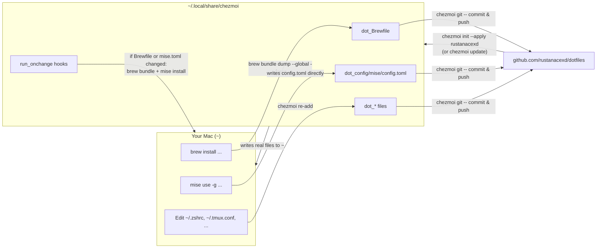

# Dotfiles

Managed with three standard tools:

- **chezmoi** for dotfiles, shell configs, Oh My Zsh plugins, and LaunchAgents
- **Homebrew (`~/.Brewfile`)** for macOS apps, CLI tools, and Cargo crates
- **mise (`~/.config/mise/config.toml`)** for language runtimes (`python`, `node`, `bun`, `go`, `java`) and global `npm`, `pypi`, and `go` CLIs

## How it works

### Where everything lives

```text
~/.local/share/chezmoi/  (git repo → github.com/rustanacexd/dotfiles)
├── dot_zshenv, dot_zprofile, dot_zshrc   # zsh startup
├── dot_bash_profile, dot_bashrc          # bash startup
├── dot_profile                           # POSIX /bin/sh startup
├── dot_Brewfile                          # Homebrew taps, formulae, casks, cargo
├── dot_tmux.conf, dot_vimrc              # editor & multiplexer
├── dot_config/
│   ├── mise/config.toml                  # runtimes + global npm/pypi/go CLIs
│   ├── ghostty/config
│   ├── starship.toml
│   └── uv/uv.toml
├── private_Library/private_LaunchAgents/ # GUI env + right-Cmd→Ctrl remap
├── .chezmoiexternal.toml                 # Oh My Zsh + fzf-tab + zsh-bat
├── .githooks/pre-commit                  # trufflehog secret blocker
└── run_onchange_after_*.sh.tmpl          # runs brew/mise/launchctl only on change

~ (live machine — real files, no symlinks)
├── ~/.zshrc, ~/.Brewfile, ~/.config/mise/config.toml, ...
├── ~/.zshenv.secrets                     # EXA_API_KEY (local only, never committed)
└── ~/.zshrc.secrets                      # AWS + Gemini keys (local only, never committed)
```

### How sync works (both directions)



### What runs when you open a terminal

```text
Open Terminal (login interactive zsh)
├── ~/.zshenv                        # always runs (scripts, agents, terminals)
│   ├── sets PATH (mise shims, homebrew, cargo, go, orbstack, opencode)
│   ├── sets brew bundle dump defaults
│   └── sources ~/.zshenv.secrets    # EXA_API_KEY
├── ~/.zprofile                      # login shells (after macOS path_helper)
│   ├── brew shellenv
│   └── re-prepends user paths ahead of /usr/bin
└── ~/.zshrc                         # interactive shells
    ├── Oh My Zsh libs + fzf-tab + zsh-bat (cached compinit)
    ├── mise activate zsh            # activates python/node/bun/go/java, JAVA_HOME, CLIs
    ├── cached init: fzf, starship, direnv, bun completions
    ├── aliases + pi() wrapper
    └── sources ~/.zshrc.secrets     # AWS + Gemini keys
```

At macOS login, `com.rustan.gui-env.plist` runs `~/.zshenv` + `mise env` so GUI apps (Zed, Raycast, Ghostty, etc.) get the same `PATH`, `JAVA_HOME`, and `EXA_API_KEY`.

## Day-to-day workflow

**Save Mac changes to GitHub:**

```sh
# 1. Snapshot any new Homebrew installs into ~/.Brewfile
brew bundle dump --global --force

# 2. Pull local edits (dotfiles, ~/.Brewfile, ~/.config/mise/config.toml) into the repo
chezmoi diff
chezmoi re-add

# 3. Commit and push
chezmoi git -- add -A
chezmoi git -- commit -m "chore: sync dotfiles"
chezmoi git -- push
```

When installing a new language CLI, use `mise use -g` so `~/.config/mise/config.toml` updates automatically:

```sh
mise use -g npm:vercel
mise use -g pypi:posting
chezmoi re-add ~/.config/mise/config.toml
```

**Pull GitHub changes to this Mac:**

```sh
chezmoi update
```

## New Mac setup

1. Install Homebrew from https://brew.sh.
2. Install `chezmoi` and apply this repo (runs `brew bundle`, `mise install`, and LaunchAgent reloads automatically):
   ```sh
   brew install chezmoi
   chezmoi init --apply rustanacexd
   ```
3. Install vendor tools that manage themselves:
   - `rustup`: `curl --proto '=https' --tlsv1.2 -fsSL https://sh.rustup.rs | sh -s -- -y --no-modify-path`
   - Claude Code: `curl -fsSL https://claude.ai/install.sh | bash`
   - Zed: `curl -fsSL https://zed.dev/install.sh | sh`
4. Recreate local secret files (never committed):
   - `~/.zshenv.secrets` (mode 600): `export EXA_API_KEY=...`
   - `~/.zshrc.secrets` (mode 600): `export AWS_ACCESS_KEY_ID=...`, `AWS_SECRET_ACCESS_KEY`, `GEMINI_API_KEY`, `GOOGLE_GENERATIVE_AI_API_KEY`
5. Open OrbStack and Karabiner-Elements once to finish permissions, then log out and back in.
